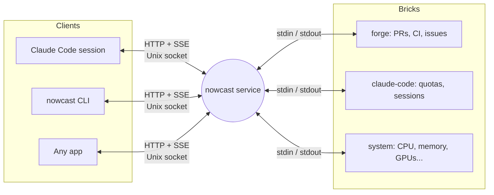

<div align="center">

# nowcast

**Live, ready-to-use data for your agent sessions and tools, served by one local service.**

[](https://github.com/phvn-orga/nowcast/actions/workflows/ci.yml)
[](https://github.com/phvn-orga/nowcast/releases)


[Features](#features) • [Install](#install) • [Quick start](#quick-start) • [Claude Code](#claude-code) • [Bricks](#bricks) • [Build on nowcast](#build-on-nowcast)

</div>

nowcast is a local service that watches sources for you (a PR and its CI, your usage quotas, the machine's resources) and publishes what it sees. Agent sessions, dashboards or any app connect, subscribe, and receive each update as it happens.

Ten agent sessions watching the same CI today means ten polling loops and ten copies of the same state. With nowcast, the source is read once, the state lives in one place, and anything on the machine can use it.

> [!WARNING]
> nowcast is in **alpha**: interfaces, formats and behaviour change without notice. Use it for testing only.

## Features

- **On demand.** systemd starts the service on the first connection; it stops after 60 s without one. No process runs while nobody listens.
- **Bricks sleep until needed.** A brick (the program that watches a source) starts with its first subscriber and stops with its last.
- **Shared, not duplicated.** Two sessions following the same branch share one flow, read once.
- **Survives disconnections.** The service keeps each flow's recent history: a client that reconnects resumes where it left off.
- **Local only.** A private Unix socket (`0600`), no TCP port: neither the network nor a browser page can reach it.
- **Observes, never acts.** nowcast reads sources; actions stay in your own tools.
- **Open to any brick.** Bricks are plain programs, in any language, declared in a TOML file.



## Install

Requires **Linux 6.5 or later** (the service identifies its peers with `SO_PEERPIDFD`) and systemd for the on-demand start.

One binary, `nowcast`, holds both the command-line client and the service (`nowcast daemon`).

### Homebrew (x86_64 Linux)

```sh
brew tap phvn-orga/nowcast https://github.com/phvn-orga/nowcast
brew install phvn-orga/nowcast/nowcast
nowcast setup
```

`nowcast setup` writes the systemd user units, enables the socket, and offers the native bricks to enable.

> [!NOTE]
> The full name `phvn-orga/nowcast/nowcast` trusts this formula alone, which Homebrew 6 and later require for a tap outside Homebrew's own.

### From source

```sh
cargo install --root ~/.local --path crates/cli
~/.local/bin/nowcast setup
```

### Upgrade and uninstall

After an upgrade, `nowcast status` tells whether the units changed and `nowcast setup` must run again. The running service keeps its old version until `nowcast reload` restarts it on the installed binary.

To uninstall, run `nowcast setup --remove` first: it stops the service and removes its units. Then `brew uninstall nowcast`.

## Quick start

Check what runs:

```sh
nowcast status
```

Follow the machine's resources live, through the `system` brick:

```sh
nowcast bricks enable system
nowcast watch --subscribe system machine '{}'
```

Watch everything the service does, full screen (bricks, sessions, flows and each event):

```sh
nowcast live
```

`nowcast --help` lists every command; `--json` makes any of them machine-readable.

## Claude Code

The Claude Code plugin connects each session to nowcast. Install the `nowcast` command first, then the plugin:

```sh
claude plugin marketplace add phvn-orga/nowcast
claude plugin install nowcast@nowcast
```

Once installed, each session:

- declares itself to the service and holds one event stream, reconnecting on its own;
- sends its measures to the `claude-code` brick, when that brick is enabled;
- follows the PR and CI of every worktree it writes in, when the `forge` brick is enabled;
- says so at startup when the service needs `nowcast setup`.

The plugin shows nothing by itself: it is a library for other mods. Every subscription and flow lands in its state, and `$.nowcast` lets a mod subscribe:

```ts
const answer = await $.nowcast.subscribe({
  name: 'pr', brick: 'forge', kind: 'pr', params: { remote, branch },
})
```

A mod using it lists `nowcast` under `dependencies` in its `plugin.json`. The [`nowcast-example`](clients/claude-code/nowcast/example/hooks/register.ts) mod is a complete one, and [`types/index.d.ts`](clients/claude-code/nowcast/types/index.d.ts) documents the API.

## Bricks

nowcast ships three native bricks, built into the binary. Each one is optional: enable only what you use.

| Brick | Publishes | Subscription kinds |
|---|---|---|
| `forge` | A branch's PR and its pipelines per job, a repository's issues, on GitHub and Azure DevOps | `pr`, `pipelines`, `issues`, `issue` |
| `claude-code` | The Claude Code account's usage quotas, and the measures of its running sessions | `quotas`, `session`, `sessions` |
| `system` | CPU, memory, GPUs, disks, network, temperatures and pressure, and what a subscriber's process tree costs (for an agent, its session), sampled every 2 s | `machine`, `process` |

Enable, configure or disable a brick:

```sh
nowcast bricks enable forge        # a native brick, by name
nowcast bricks enable ./brick.toml # any other brick, by its declaration file
nowcast bricks configure forge     # run its configuration again (an expired token)
nowcast bricks disable forge
```

A brick that needs credentials, like `forge`, asks for them in your terminal when enabled. Each subscription kind takes parameters described by a JSON Schema, in the brick's `schemas/` directory ([forge](bricks/forge/schemas), [claude-code](bricks/claude-code/schemas), [system](bricks/system/schemas)).

> [!NOTE]
> While the `machine` flow is subscribed, `system` pings the gateway and two public resolvers (9.9.9.9 and 1.1.1.1) every 2 s.

## Build on nowcast

### Consume data from any app

Clients talk HTTP over the service's Unix socket, and receive updates as Server-Sent Events in CloudEvents JSON. A first look:

```sh
curl --unix-socket "$XDG_RUNTIME_DIR/nowcast/nowcast.sock" http://localhost/v1/status
```

A client declares its session (`PUT /v1/session`), subscribes (`POST /v1/subscriptions`) and reads its stream (`GET /v1/stream`). Calling the `nowcast` CLI with `--json` is often simpler: it already handles reconnection and an absent service.

### Write your own brick

A brick is any program the service launches. It talks to the service in length-prefixed MessagePack frames on stdin and stdout, and publishes JSON. A TOML file declares its command, its subscription kinds and the JSON Schemas of what it publishes; [`bricks/system/brick.toml`](bricks/system/brick.toml) is a short example.

The full contracts (client API, brick protocol, declaration format) are in the [design notes](https://github.com/phvn-orga/nowcast/tree/design/docs/design), written in French.

## Troubleshooting

### A brick cannot find its program

A brick whose command starts with a bare program name (`node`, `python3`) looks for it in the service's `PATH`. Under systemd, that is the user manager's `PATH` (`systemctl --user show-environment`), which lacks the runtimes version managers install per user (fnm, nvm, mise, asdf). `nowcast bricks enable` refuses such a brick (`--force` enables it anyway), and a subscription to it fails with the cause.

Give the service a directory that stays put (for fnm, `~/.local/share/fnm/aliases/default/bin`, not the per-shell `fnm_multishells` path), at the scope you need:

| Scope | How |
|---|---|
| Every user service | A file in `~/.config/environment.d/` that sorts after the distribution's own (`999-nowcast.conf`), with `PATH=$HOME/.local/share/fnm/aliases/default/bin:$PATH`, then `systemctl --user daemon-reload` |
| The nowcast service only | `systemctl --user edit nowcast.service`, with `Environment=PATH=…` under `[Service]`. systemd expands no variable there: write the whole `PATH` |
| One brick | `PATH` in its declaration's `[run] env`, which replaces the service's, or an absolute path as its program |

The new `PATH` applies once the service starts again: `systemctl --user stop nowcast.service`, and the socket restarts it on the next connection.

### Run the service by hand

`nowcast daemon` runs the service in the foreground, logging to stderr (`NOWCAST_LOG` sets the filter). `nowcast daemon --help` lists the variables it reads.
